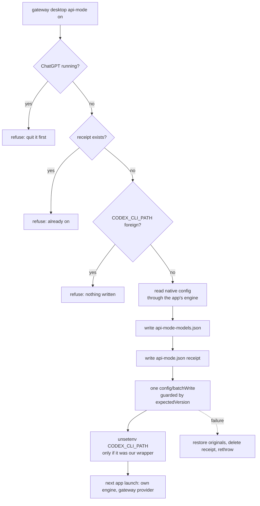

# API mode

API mode is an opt-in desktop setup. The ChatGPT app starts **its own signed Codex
engine** and keeps every one of its own tools, and Harness Gateway serves that engine
as a plain Responses model provider. There is no adapter between them.

```text
Adapter mode (default)                    API mode
ChatGPT.app                               ChatGPT.app
  └─ engine  ← CODEX_CLI_PATH wrapper       └─ its own signed engine
       └─ gateway shim ── translation            └─ config: model_provider = "harness_gateway"
            └─ provider inference                     └─ base_url = http://127.0.0.1:<port>/v1
app tools: unavailable                    app tools: available on every gateway model
```

## Why it exists

The app's `codex_app` tools (`automation_update`, `create_thread`, …) reach the app
through a pipe that only trusts an OpenAI-signed engine process chain. The adapter is
an unsigned Node process sitting in that chain, so with the adapter in place those
tools are out of reach no matter what the model asks for. [Client tool
reachability](client-tool-reachability.md) covers the wider question of which tools a
client can see on a gateway model; this is the one class of tools the adapter cannot
reach at all, because the boundary is process signing rather than tool exposure.

## What API mode changes

`gateway desktop api-mode on` writes four things into the **native** Codex
configuration, and nothing else:

| Key | Value |
| --- | --- |
| `model_providers.harness_gateway` | this gateway: loopback `/v1`, `wire_api = "responses"`, no websockets, 2 retries, 90 s idle timeout, and the `gateway token` helper as its auth command |
| `model_provider` | `harness_gateway` |
| `model_catalog_json` | `<state>/api-mode-models.json`, this gateway's model list |
| `model` | `--model`, else the model already in use when the gateway serves it, else the first listed row |

Every model goes through that provider, GPT included. A native catalog row cannot name
a provider, so a row that bypassed the gateway would be the only model in the picker
that the gateway is not serving — and the whole point is one model list with one set of
tools. `off` puts back exactly what `on` found, key by key, and clears the ones that
were absent.

Storing the gateway's provider and catalog file in the user's own `config.toml` is a
deliberate exception to the rule the adapter follows for native configuration writes
([app-server](app-server.md), enforced in `src/app-server-config-writes.ts`). That rule
exists because adapter rows only live as long as the
adapter runs, so a saved gateway model would break the next plain Codex start. In API
mode the rows are the point and they are permanent by design — which is also why the
receipt exists and why `off` must run before that configuration is anyone else's problem.

## The flow



The engine does the editing. `gateway desktop api-mode` starts
`ChatGPT.app/Contents/Resources/codex-cli/bin/codex app-server --listen stdio://` with
`CODEX_HOME` pointed at the native home, initializes as `harness_gateway_api_mode` with
the experimental API, and uses `config/read` and `config/batchWrite`. It never parses or
rewrites `config.toml` itself, so comments, key order and every setting the gateway does
not own come back untouched. Each write carries the `expectedVersion` the read reported,
so a configuration edited meanwhile fails instead of being clobbered. A key is cleared by
writing `null`, which the engine's own writer removes.

## The switch, and what is held back

`<state>/api-mode.json` (mode 0600) is the only thing that distinguishes API mode from
the adapter on a machine:

```json
{ "version": 1, "nativeHome": "/Users/you/.codex",
  "original": { "model": "gpt-5.1" }, "providerTableExisted": false,
  "applied": { "provider": "harness_gateway", "catalogPath": "<state>/api-mode-models.json", "model": "codex/gpt-6.1-sol" },
  "cliPathCleared": true, "enabledAt": "2026-10-25T10:00:00Z" }
```

`original` records presence and value of the three user-layer keys API mode moves, so an
absent key goes back absent rather than empty. It is written **before** the batch write,
so a crash in between leaves the record that says what to undo; `off` removes it last.

While it exists, every path that would arm the adapter stands down. The daemon's
first-step `launchctl setenv` preset and the service's `desktop-restore` child skip and
record one `desktop_api_mode` event (`action: "preset"`, `outcome: "skipped"`) per
process; a hand-run `gateway desktop register` refuses. The desktop registration receipt
and the service plan are **not** changed: API mode only takes `CODEX_CLI_PATH` out of the
login session, and only when the session's value was one of this gateway's own wrappers.
A foreign override is refused before anything is written, because API mode could not hand
it back. `gateway desktop status` reports this as `cliPathOverride:
"gateway"|"none"|"other"`, never the path itself.

The catalog stays current without a timer or another background item: the running service
rewrites it at the moment it adopts a new gateway configuration, and only while the
receipt exists. A model added to the gateway therefore reaches the app's picker with no
restart, and an app that starts after a `gateway service restart` still reads the same
list.

## What API mode gives up

| Lost beside adapter mode | Why |
| --- | --- |
| Shared executor survival | No adapter means no gateway-owned engine: quitting the app or losing its connection ends the chat's execution, and the SSH/durable-chat paths that lean on the shared executor are not in play. |
| Gateway SDK patches | The deferred-tool fallback in `scripts/patches/gateway-dynamic-tools.patch` and the rest of the pinned gateway SDK never load, so a caller-declared deferred tool on a model without tool search stays hidden. |
| Adapter compaction, effort and tier handling | Adapter-side compaction, reasoning-effort translation and service-tier selection happen in the shim; API mode sends whatever the app's own engine sends. |
| A mixed native + gateway model list | The adapter merges the native catalog with the gateway's rows. API mode replaces the list with the gateway's rows only: `model_catalog_json` can point at one file, and a native row cannot name the gateway provider. |
| The gateway's own chat identity | Rows are plain provider rows; the account-scoped naming and classification the adapter records do not apply. |

Keep the adapter for shared executors, durable chats, SSH and the patched SDK. Choose API
mode when an app feature that only exists as a `codex_app` tool matters more.

## Using it

```text
gateway desktop api-mode on                  # macOS, gateway running here, ChatGPT quit
gateway desktop api-mode on --model ALIAS    # a specific row from `gateway catalog`
gateway desktop api-mode status
gateway desktop api-mode off
```

Quit ChatGPT (Command-Q) first: both `on` and `off` refuse while it is running, because
the configuration only takes effect at the next launch. `off` then restores the native
configuration and re-arms the adapter through the same preset the service uses, so the
next launch is back in adapter mode. A `clientOnly` gateway refuses `on` — API mode needs
a gateway running on this Mac.

`scripts/e2e-api-mode-native-config.mjs` runs the real `on`/`off` logic against the app's
real signed engine in a throwaway native home and checks the resulting `config.toml`
round trip. It never launches the app and never touches a login session.

## Telemetry

One event, `desktop_api_mode`, with exactly `action` (`on`, `off`, `preset`), `outcome`
(`applied`, `refused`, `rolled_back`, `failed`, `skipped`) and a fixed `reason` when there
is one. No path, model, configuration value or environment value is ever recorded. See
[diagnostics](diagnostics.md).
