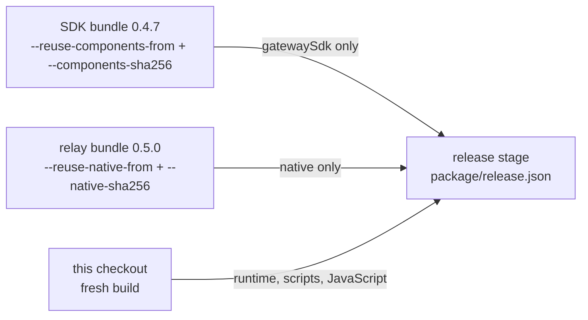

# Component origins

A release can carry a component from an earlier published bundle. The bundle that
supplies a component is its **origin**, and the origin is recorded per component.



`package/release.json` keeps the legacy top-level `bundleVersion` / `bundleSha256`,
which name the reused SDK bundle when present, otherwise the reused relay bundle.
Each component also has its own `origin`, so the relay can point at a separate archive:

```json
{ "reusedComponents": { "bundleVersion": "0.4.7", "bundleSha256": "…",
  "components": {
    "gatewaySdk": { "buildVersion": "0.4.7", "sourceSha256": "…",
      "origin": { "bundleVersion": "0.4.7", "bundleSha256": "…" }, "files": [] },
    "native": { "buildVersion": "0.5.0", "sourceSha256": "…",
      "origin": { "bundleVersion": "0.5.0", "bundleSha256": "…" }, "files": [] } } } }
```

## Rules

- Each archive is authenticated on its own: whole-archive SHA-256, safe tar entries,
  the complete checksum manifest, the six component files, its own upstream pins,
  release profile, source digest, and (for the gateway SDK) its capability. The
  native binary bytes are authenticated by the whole-archive checksum and the
  complete manifest; the relay's original receipt carries no `binarySha256` field,
  so only the SDK's receipt hash is additionally checked against its archived
  binary. Only the named component paths are taken from it; two origins can never
  supply the same path.
- An archive that already reused the selected component is refused. Reuse the
  bundle that built it, so the receipt's bytes stay the original's.
- `--reuse-native-from` requires `--native-sha256`, both `--with-native` and
  `--with-gateway-sdk`. Without the SDK reuse pair, the SDK must pass the normal
  fresh-build checks. With `--reuse-components-from` and `--components-sha256`,
  each component comes from its independently authenticated original archive.
  Native reuse excludes `--fresh-native`.
- Runtime resolution (src/gateway-sdk-runtime.ts): a component `origin` that is
  complete and valid wins; a missing `origin` falls back to the parent receipt, so
  releases built before this field still verify. A present but partial or malformed
  `origin` fails closed, with no fallback.
- Receipts and binaries are copied byte for byte. Re-copied files are re-hashed
  against the verified digest before they reach the stage.

## Signed macOS executor

Managed macOS installations prefer the signed gateway SDK inside the app when its
signed receipt identifies the exact original executor and Code Mode companion in
the selected CLI release. The app and helper must pass Developer ID and fixed
identifier checks, and the signed package is verified before and after signature
validation. The executor path is stable across app releases; its Developer ID
identity allows macOS to recognize Keychain access grants across updates. The
original CLI checksum remains the compatibility identity exchanged by clients
and the service. A missing, changed or mismatched app falls back to the verified
CLI executor, preserving CLI-only installations and release-skew behavior.

This does not prove that Keychain will retain an existing grant: confirm an
approval on the signed executor and check a later restart and app update on the
unlocked Mac. macOS can ask again for other credentials or changed access rules.
For unattended MCP OAuth operations, see [MCP credential storage](mcp-credentials.md).
